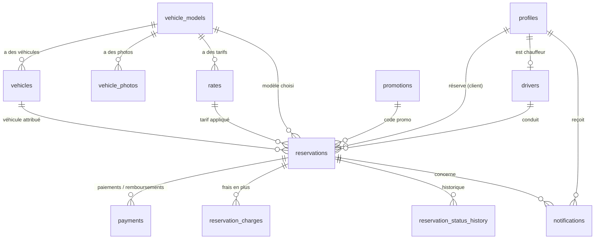
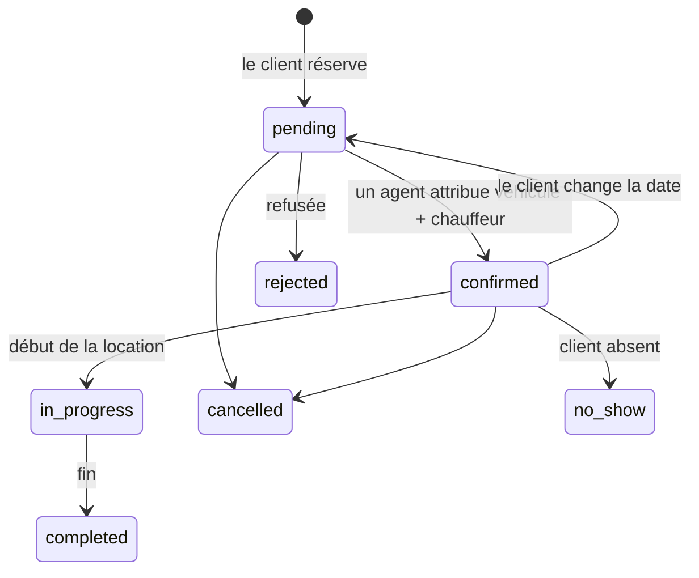

# Base de données Zoko

PostgreSQL hébergé sur **Supabase** (comptes, base, stockage des photos, sécurité par rôle).

- Schéma : [`supabase/migrations/20261122120000_initial_schema.sql`](../supabase/migrations/20261122120000_initial_schema.sql)
- Données de départ (modèles, tarifs, paramètres) : [`supabase/seed.sql`](../supabase/seed.sql)

## Schéma des tables

## Les tables

| Table | Rôle |
|---|---|
| `profiles` | Chaque utilisateur : client ou équipe. Le **rôle** décide des droits : `client`, `manager` (gérante), `agent`, `driver`, `accountant`, `admin`. |
| `vehicle_models` | Ce que le client choisit : S-Presso, Jimny, Fronx (places, boîte, équipements). |
| `vehicles` | Les véhicules réels (une plaque = une ligne). Une réservation est attribuée à un véhicule précis. |
| `vehicle_photos` | Photos de chaque modèle. |
| `rates` | Tarifs 6 h / 12 h par modèle, **avec historique** : un changement de prix ajoute une ligne, les anciennes réservations gardent leur prix. |
| `drivers` | Infos chauffeur (permis, disponibilité). L'entreprise attribue le chauffeur. |
| `promotions` | Codes promo (% ou montant fixe, dates, nombre d'utilisations max). |
| `reservations` | Le cœur : client, modèle, véhicule, chauffeur, date, durée, lieu de prise en charge, prix, statut. |
| `reservation_charges` | Frais ajoutés après coup : dépassement horaire, carburant au-delà des 5 L. |
| `payments` | Paiements et remboursements : Airtel Money, MTN Mobile Money, virement. |
| `reservation_status_history` | Qui a changé le statut, quand : **traçabilité complète**. |
| `notifications` | Notifications dans l'app pour les clients et l'équipe. |
| `app_settings` | Règles modifiables sans toucher au code (délai minimum, remboursement le jour J...). |

## Vie d'une réservation

## Règles appliquées par la base (pas seulement par l'app)

Même si l'application a un bug, la base refuse les erreurs :

- **Prix calculé par le serveur** à partir du tarif en vigueur et du code promo. Un prix envoyé par l'app est ignoré.
- **Réservation au moins 1 jour à l'avance** (réglable dans `app_settings`).
- **Durées 6 h ou 12 h** uniquement.
- **Pas de double réservation** : un véhicule, ou un chauffeur, ne peut pas avoir deux locations confirmées qui se chevauchent.
- Le véhicule attribué doit être du **modèle réservé**.
- Un client ne peut ni confirmer sa réservation, ni valider son paiement, ni changer son rôle.
- Un client peut **modifier ou annuler** tant que la location n'a pas commencé. Si une réservation confirmée change de date, elle repasse en attente.
- Les **notifications** et l'**historique** sont créés automatiquement : nouvelle réservation, confirmation, paiement, début et fin de location.

## Qui voit quoi

| | Client | Chauffeur | Agent | Comptable | Gérante / Admin |
|---|---|---|---|---|---|
| Catalogue et tarifs | ✔ | ✔ | ✔ | ✔ | ✔ + modifier |
| Ses réservations | ✔ | celles qu'il conduit | toutes | toutes (lecture) | toutes |
| Paiements | les siens | — | tous + valider | tous + valider | tous |
| Véhicules (plaques) | — | ✔ | ✔ | ✔ | ✔ + modifier |
| Rapports | ses chiffres | — | ✔ | ✔ | ✔ |
| Rôles des comptes | — | — | — | — | ✔ |

## Rapports prêts à l'emploi (vues SQL)

| Vue | Contenu |
|---|---|
| `reservation_details` | Une ligne par réservation avec tout le contexte : client, véhicule, chauffeur, montants, solde. Idéal pour les exports. |
| `reservation_balances` | Pour chaque réservation : montant dû, payé, remboursé, reste à payer. |
| `report_daily_activity` | Par jour : réservations, confirmées, annulées, heures louées, chiffre réservé. |
| `report_monthly_revenue` | Par mois et par moyen de paiement : encaissé, remboursé, net. |
| `report_vehicle_performance` | Par mois et par véhicule : nombre de locations, heures, revenu. |
| `report_model_demand` | Modèles et durées les plus demandés, demandes perdues. |
| `report_client_stats` | Par client : réservations, annulations, total dépensé, dernière location. Base du programme de fidélité. |
| `report_driver_activity` | Par mois et par chauffeur : courses et heures. |

## Fonctions utilisées par l'app

| Fonction | Rôle |
|---|---|
| `vehicle_catalog(id?)` | Le catalogue : modèles actifs, tarifs en vigueur, photos, nombre de véhicules. Lisible **avant connexion**. Utilisée par l'accueil, le catalogue et la fiche véhicule. |
| `available_models(date, durée)` | Nombre de véhicules libres par modèle pour un créneau, en **temps réel**. |

## Photos des véhicules

La migration `20261122130000_vehicle_photos_storage.sql` crée l'espace de stockage public `vehicle-photos`. Pour ajouter une photo : l'envoyer dans **Storage > vehicle-photos**, copier son URL publique, puis l'ajouter dans la table `vehicle_photos` (`position` 0 = photo principale).

## Paramètres modifiables (`app_settings`)

Tout ce que l'app affiche et qui peut changer vient de la table `app_settings` (colonne `is_public = true` : lisible par l'app). Pour modifier : **Table Editor > app_settings > value**. L'app prend la nouvelle valeur au prochain lancement.

| Clé | Exemple | Utilisée pour |
|---|---|---|
| `city` | `"Pointe-Noire"` | Catalogue |
| `min_days_ahead` / `max_days_ahead` | `1` / `30` | Dates proposées (aussi vérifié par la base) |
| `booking_hours` | `{"start": "06:00", "end": "20:00", "step_minutes": 30}` | Heures de début proposées (aussi vérifié par la base) |
| `included_fuel_liters` | `5` | « Bon à savoir » de la réservation |
| `free_cancel_until_days_before` / `same_day_cancel_refund_pct` | `1` / `50` | Politique d'annulation affichée |
| `booking_conditions` | `["Pièce d'identité obligatoire", ...]` | Conditions affichées à la réservation |
| `welcome_tagline`, `home_subtitle`, `home_banner`, `pricing_note` | textes | Textes de l'app |
| `support_phone`, `support_whatsapp` | `""` | Contact (à remplir) |
| `currency_label`, `utc_offset`, `timezone` | `"FCFA"`, `"+01:00"` | Affichage des prix et des heures |

Les **durées** (6 h, 12 h...) viennent des **tarifs** : ajouter un tarif 24 h pour un modèle suffit pour que l'app propose 24 h.

## Comptes

- Inscription : nom, **e-mail** (obligatoire), **téléphone** (obligatoire, unique), mot de passe.
- Connexion : **e-mail + mot de passe**.
- `email_registered(e-mail)` et `phone_registered(numéro)` indiquent seulement si un compte existe (oui / non), pour afficher « Aucun compte avec cet e-mail », « Un compte existe déjà » ou « Ce numéro est déjà utilisé ».
- Un même numéro ne peut avoir qu'un compte, quel que soit le format saisi (`06 123 45 67`, `+242 06...`).
- « Mot de passe oublié » par e-mail : nécessite un expéditeur e-mail (SMTP) personnalisé dans Supabase, car l'expéditeur par défaut n'écrit qu'aux membres de l'équipe du projet.

## Mise en place

1. Créer un projet sur [supabase.com](https://supabase.com) (région la plus proche : Europe ou Afrique du Sud).
2. **Authentication > Sign In / Providers > Email** : désactiver **Confirm email** (sinon chaque client doit cliquer un lien reçu par e-mail avant de se connecter, et l'expéditeur par défaut de Supabase n'écrit qu'aux membres de l'équipe).
3. **SQL Editor** : exécuter les 10 fichiers de `supabase/migrations/` **dans l'ordre**, puis `supabase/seed.sql`.
4. **Project Settings > API** : copier l'URL et la clé publique (publishable / anon) dans `.env.local` à la racine du projet, puis relancer `npx expo start --clear`.
5. Créer le compte de la gérante depuis l'app (« Créer un compte »), puis dans le SQL Editor :
   `update profiles set role = 'manager' where email = 'gerante@exemple.com';`
6. Remplacer les plaques `A-RENSEIGNER-...` par les vraies et ajouter le 4ᵉ véhicule (Table Editor > vehicles).
